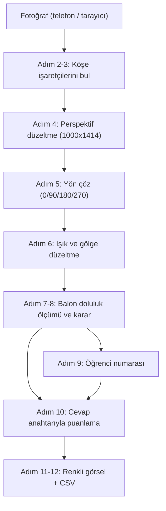

# Optik Form Okuyucu (OpenCV ile OMR)

Telefonla çekilmiş ya da taranmış bir **optik formu** otomatik olarak düzleştiren (hizalayan), **işaretli şıkları tespit eden** ve **cevap anahtarına göre puanlayan** Python projesi. Sadece `opencv-python` ve `numpy` kullanır.

OMR = *Optical Mark Recognition* (Optik İşaret Tanıma).

| 1) Fotoğrafta köşelerin bulunması | 2) Puanlanmış sonuç |
|---|---|
|  |  |

---

## İçindekiler

1. [Proje ne yapıyor?](#1-proje-ne-yapıyor)
2. [Kurulum ve çalıştırma](#2-kurulum-ve-çalıştırma)
3. [Genel akış](#3-genel-akış)
4. [Adım adım: yapılanlar ve nedenleri](#4-adım-adım-yapılanlar-ve-nedenleri)
5. [Karşılaşılan sorunlar ve çözümleri](#5-karşılaşılan-sorunlar-ve-çözümleri)
6. [Test ve doğrulama](#6-test-ve-doğrulama)
7. [Ayarlanabilir parametreler](#7-ayarlanabilir-parametreler)
8. [Kendi sınavın için kullanım](#8-kendi-sınavın-için-kullanım)
9. [Proje yapısı](#9-proje-yapısı)
10. [Sınırlar ve geliştirme fikirleri](#10-sınırlar-ve-geliştirme-fikirleri)

---

## 1. Proje ne yapıyor?

Öğretmen sınav kâğıtlarını tek tek elle puanlamak yerine, öğrencilerin doldurduğu optik formun fotoğrafını çeker. Program:

1. Formu fotoğrafta bulup **düzleştirir** (eğik, yan, baş aşağı çekilmiş olsa bile),
2. Her sorunun hangi şıkkının **işaretlendiğini** okur (boş ve çift işaret dahil),
3. **Öğrenci numarasını** okur,
4. **Cevap anahtarıyla** karşılaştırıp puanı hesaplar,
5. Sonucu **renkli görsel** ve **CSV tablosu** olarak kaydeder.

Özellikler:

- 40 soru × 5 şık (A–E) ve 8 haneli öğrenci numarası
- Perspektif düzeltme ve 0/90/180/270° dönmüş fotoğraf desteği
- Işık/gölge farklarına dayanıklı okuma
- Yanlış cezası (ör. 4 yanlış 1 doğruyu götürür) ve iptal soru desteği
- Tek komutla klasördeki tüm kâğıtları puanlama, Excel'de açılabilir CSV
- Kamerasız test için "sahte fotoğraf" üreticisi ve otomatik testler
- Türkçe karakterli klasör yollarında çalışır

---

## 2. Kurulum ve çalıştırma

Python 3.9 veya üzeri gerekir.

```bash
git clone https://github.com/MerveTatvan/optik-form-okuyucu.git
cd optik-form-okuyucu

python3 -m venv .venv
source .venv/bin/activate          # Windows PowerShell: .venv\Scripts\Activate.ps1
pip install -r requirements.txt

python main.py demo
```

`demo` komutu örnek öğrenci fotoğrafları üretir (`samples/`), puanlar ve sonuçları `outputs/` klasörüne yazar. Beklenen çıktı:

```
ogrenci_01.jpg   No: 20240101  D:35 Y: 2 B: 3 Cift: 0  PUAN: 87.5/100
ogrenci_02.jpg   No: 20240102  D:23 Y:15 B: 2 Cift: 0  PUAN: 57.5/100
ogrenci_03.jpg   No: 20240103  D:26 Y: 8 B: 5 Cift: 1  PUAN: 65/100
```

(D: doğru, Y: yanlış, B: boş, Cift: birden fazla şık işaretlenmiş)

VS Code'da `F5` ile hazır **Demo** yapılandırması çalışır. Testler için `pytest` yazın.

---

## 3. Genel akış



Kod tarafında her kutunun karşılığı bir modüldür:

| Aşama | Dosya |
|---|---|
| Form düzeni, üretim | `omr/layout.py`, `omr/formgen.py` |
| Görüntü okuma/yazma | `omr/io.py` |
| Köşe bulma, düzeltme, yön | `omr/align.py` |
| Balon okuma, öğrenci no | `omr/reader.py` |
| Puanlama | `omr/grader.py` |
| Renkli sonuç görseli | `omr/visualize.py` |
| Uçtan uca akış | `omr/pipeline.py` |
| Komut satırı | `main.py` |

---

## 4. Adım adım: yapılanlar ve nedenleri

### Adım 1: Optik formu tasarlamak (`omr/layout.py`, `omr/formgen.py`)

**Problem:** Hazır bir formun balon konumlarını bilmiyorsak okumak için her seferinde bulmamız gerekir. Bu hem yavaş hem hataya açık.

**Çözüm:** Formu kendimiz tasarladık ve tüm konumları tek bir dosyada sabit koordinatlar olarak tuttuk. Form üretici ve okuyucu **aynı sabitleri** kullandığı için birbirine her zaman uyumlu.

Form, A4 oranında (1 : 1,414) **1000 × 1414 piksellik** bir "kanonik" tuval olarak tanımlandı:

| Öğe | Değer |
|---|---|
| Köşe işaretçileri | 40×40 px siyah kare; merkezleri (50,50) (950,50) (950,1364) (50,1364) |
| Yön çubuğu | 70×16 px siyah dikdörtgen, merkezi (135,50) |
| Cevap balonları | 40 soru, 2 sütun × 20 satır, 5 şık (A–E), yarıçap 12 px |
| Cevap konumu | Sütun x'leri 170 ve 630, şık aralığı 50 px, ilk satır y=680, satır aralığı 33 px |
| Öğrenci no | 8 hane × 10 rakam (0–9); ilk hane x=130, hane aralığı 46 px, ilk satır y=260, satır aralığı 34 px |

Herhangi bir balonun koordinatı iki küçük fonksiyonla hesaplanır:

```python
def answer_bubble_center(q, opt):          # q: soru indeksi, opt: şık indeksi (A=0)
    col, row = divmod(q, QUESTIONS_PER_COLUMN)
    return ANSWER_X0[col] + opt * ANSWER_X_STEP, ANSWER_Y0 + row * ANSWER_Y_STEP
```

`python main.py generate-form` komutu bu koordinatlara göre yazdırılabilir boş formu (`forms/bos_form.png`, 2000×2828 px) çizer.

**Neden dört köşede siyah kare var?** Kâğıdın kenarını bulmaya çalışmak (masa, gölge, el yüzünden) kırılgandır. Basılı siyah kareler ise hem hızlı hem güvenilir referans noktalarıdır. **Yön çubuğu** ise formun baş aşağı ya da yan çekilip çekilmediğini anlamak içindir: dört köşe kare birbirine benzediği için tek başlarına yön vermezler.

> Not: OpenCV'nin yazı tipleri Türkçe karakterleri çizemediği için form üzerindeki yazılar ASCII'dir (`OGRENCI NO`, `CEVAPLAR`).

---

### Adım 2: Fotoğrafı yüklemek (`omr/io.py`)

OpenCV'nin `cv2.imread` ve `cv2.imwrite` fonksiyonları **Windows'ta yolda Türkçe karakter** (ç, ğ, ş, ö, ü, ı) varsa sessizce başarısız olur. Bu yüzden dosyayı numpy ile okuyup OpenCV'ye bellekten veriyoruz:

```python
data = np.fromfile(str(path), dtype=np.uint8)
img = cv2.imdecode(data, cv2.IMREAD_COLOR)
```

Yazarken de `cv2.imencode(...)` ile bayt dizisi üretip `.tofile()` ile kaydediyoruz. Böylece `C:\Users\Çağrı\Masaüstü\fotoğraf.jpg` gibi yollar sorunsuz çalışır.

Ayrıca çok büyük fotoğraflar (telefon 4000+ piksel üretir) işlemeyi yavaşlatmasın diye uzun kenar **1800 piksele** küçültülür (`INTER_AREA` ile).

---

### Adım 3: Köşe işaretçilerini bulmak (`omr/align.py`)

Amaç: fotoğrafta dört siyah kareyi bulmak. Dört alt adımdan oluşur.

**3a) Işık farkını gidermek.** Fotoğrafta bir yan daha aydınlık, bir yan gölgeli olabilir. Tek bir eşikle siyah/beyaz ayırmak bu durumda hata yapar. Önce arka plan ışığını tahmin ediyoruz: gri görüntüye büyük bir çekirdekle **morfolojik kapama** (closing) uygulamak, çekirdekten küçük koyu nesneleri (işaretçiler, yazılar, balonlar) siler ve geriye sadece arka plan ışığını bırakır. Görüntüyü bu arka plana bölünce ışık farkı kalkar:

```python
k = max(31, int(max(h, w) * 0.06) | 1)       # işaretçiden büyük çekirdek
bg = cv2.morphologyEx(gray, cv2.MORPH_CLOSE, kernel)
norm = cv2.divide(gray, bg, scale=255)       # kâğıt ~255, koyu nesneler düşük
```

**3b) İkili görüntüye çevirmek.** `Otsu` yöntemi, koyu ve açık piksel gruplarını ayıran eşiği kendisi seçer. Ardından küçük lekeleri temizlemek için 3×3 açma (opening) uygulanır.

**3c) Konturlar arasından "kare" olanı seçmek.** `findContours` yüzlerce kontur bulur (harfler, balonlar, gürültü). Her kontur şu filtrelerden geçer:

| Filtre | Koşul | Neden |
|---|---|---|
| Alan | görüntü alanının %0,015 ile %1'i arasında | Çok küçük gürültüyü ve çok büyük şeyleri (masa, kâğıt kenarı) eler |
| En/boy oranı | kısa kenar / uzun kenar ≥ 0,65 | Kareye yakın olmalı; yön çubuğu (70×16) burada elenir |
| Doluluk (extent) | kontur alanı / sınırlayıcı dikdörtgen alanı ≥ 0,85 | **Dolu daire ≈ 0,78**, dolu kare ≈ 1: işaretlenmiş balonlar köşe sanılmasın diye |
| Dışbükeylik (solidity) | kontur alanı / dışbükey zarf alanı ≥ 0,90 | Girintili, düzensiz şekilleri eler |

Doluluk filtresi önemli: işaretlenmiş balonlar siyah ve yuvarlaktır, aksi halde köşe işaretçisi sanılabilirlerdi.

**3d) Dört köşeyi seçip sıralamak.** Geriye kalan adayların ağırlık merkezleri alınır ve şu mantıkla sıralanır (`s = x + y`, `d = y − x`):

| Köşe | Seçim |
|---|---|
| Sol üst | `s` en küçük |
| Sağ üst | `d` en küçük |
| Sağ alt | `s` en büyük |
| Sol alt | `d` en büyük |

Dört köşe bulunamazsa ya da seçilen dörtgen görüntünün %8'inden küçükse program anlaşılır bir hata mesajıyla durur ("Köşe işaretçileri bulunamadı", "Form görüntüde çok küçük").

---

### Adım 4: Perspektif düzeltme (`omr/align.py`)

Fotoğraftaki dört köşe noktası ile kanonik formdaki dört köşe noktası arasındaki **perspektif dönüşüm matrisi** hesaplanır ve form 1000×1414 piksellik düz bir görüntüye açılır:

```python
M = cv2.getPerspectiveTransform(src, dst)      # dst = kanonik köşe merkezleri
warped = cv2.warpPerspective(gray, M, (FORM_W, FORM_H))
```

Bundan sonra her balon, **her fotoğrafta aynı piksel koordinatındadır**. Eğik çekim, uzaktan çekim, hafif döndürme fark etmez.

---

### Adım 5: Yönü çözmek (`omr/align.py`)

Dört köşe kare birbirine benzer, bu yüzden form 90° yan ya da 180° baş aşağı çekilmişse yukarıdaki sıralama formu yanlış eşler. Bunu yön çubuğuyla çözüyoruz:

1. Köşe sırasını 4 farklı şekilde kaydır (`np.roll`) → 4 olası dönüş (0°, 90°, 180°, 270°).
2. Her birinde formu düzleştir.
3. Yön çubuğunun olması gereken yere (135, 50) bak: orası **koyuysa** doğru yön budur.
4. En yüksek koyuluk skorunu veren dönüşü seç. Skor 100'ün altındaysa hata ver (bar bulunamadı).

```python
score = 255 - patch.mean()      # patch: yön çubuğunun olması gereken küçük bölge
```

Böylece fotoğraf telefonu yan tutarak çekilse bile (demodaki `ogrenci_03.jpg` tam böyle) doğru okunur.

---

### Adım 6: Işık ve gölge normalizasyonu (`omr/reader.py`)

Düzleştirilmiş formda tekrar ışık düzeltmesi yapılır. Bu sefer çekirdek **41×41 elips** ve arka plan ayrıca **Gauss bulanıklığıyla** (σ=8) yumuşatılır. 41 piksel, bir balondan (çap 24) büyük olduğu için balonlar ve işaretler "arka plan" sayılmaz, silinirler:

```python
bg = cv2.morphologyEx(gray, cv2.MORPH_CLOSE, ellipse_41x41)
bg = cv2.GaussianBlur(bg, (0, 0), 8)
norm = cv2.divide(gray, bg, scale=255)
```

Sonuç: kâğıt her yerde ~255, kurşun kalem ya da mürekkep ise belirgin koyu. Sayfanın bir tarafındaki gölge okuma sonucunu etkilemez. (Debug görseli: `4_isik_duzeltilmis.png`.)

---

### Adım 7: Her balonun doluluğunu ölçmek (`omr/reader.py`)

Her balon için merkezinde **yarıçapı 8 piksel** olan bir daire maske alınır. Balon yarıçapı 12 olduğu için bu daire, **basılı çember çizgisini dışarıda bırakır**. Aksi halde boş balonlar da çizgi yüzünden biraz "dolu" görünürdü.

Maske içindeki pikseller için `norm < 190` olanlar "koyu" sayılır. **Doluluk oranı** = koyu piksel sayısı / maske piksel sayısı. Boş balonda ~0, tam doldurulmuş balonda ~1.

```python
dark = norm < p.dark_level                  # dark_level = 190
ratio = patch[mask].mean()                  # 0.0 ... 1.0
```

Neden "ortalama gri değeri" yerine "koyu piksel oranı"? Soluk bir kurşun kalem işareti ortalamayı az değiştirir ama koyu piksel oranı yine belirgindir. Ayrıca silinmiş leke gibi tek bir koyu nokta oranı çok yükseltmez.

---

### Adım 8: İşaretli mi, boş mu? Karar kuralı (`omr/reader.py`)

Bir sorunun 5 şıkkının doluluk oranlarına bakılır. **Oranı 0,40 veya üstü** olan balon "işaretli" sayılır:

| Kaç şık işaretli? | Sonuç |
|---|---|
| 0 | **Boş** (`None`) |
| 1 | O şıkkın harfi (`A`–`E`) |
| 2 veya daha fazla | **Çift işaret** (`*`), geçersiz sayılır |

0,40 eşiği, yarım doldurulmuş balonları yakalarken hafif lekeleri işaret saymayacak şekilde seçildi. Hem `--mark-ratio` hem `--dark-level` komut satırından değiştirilebilir (bkz. [Parametreler](#7-ayarlanabilir-parametreler)).

---

### Adım 9: Öğrenci numarasını okumak (`omr/reader.py`)

Öğrenci numarası alanında 8 hane vardır ve her hanenin altında 0–9 balonları dizilidir. Her hane aynı kuralla okunur: tam **bir** balon işaretliyse o rakam, aksi halde (boş ya da çift işaret) **`?`** yazılır. Örneğin `2024?103` çıktısı, 5. hanenin okunamadığını gösterir. Bu sayede hatalı bir numara sessizce kabul edilmez, öğretmen sorunu fark eder.

---

### Adım 10: Cevap anahtarıyla puanlama (`omr/grader.py`)

Cevap anahtarı `data/answer_key.json` dosyasından okunur:

```json
{
  "exam_name": "Örnek Sınav",
  "answers": "ABCDEABCDEBCDEACDEABEDCBAEDCBADCBAEBCDAE",
  "points_per_question": null,
  "wrong_penalty": 0.0
}
```

Anahtar yüklenirken **doğrulanır**: 1–40 soru, yalnızca `A–E` ya da `X` harfleri kabul edilir, aksi halde anlaşılır bir hata verilir.

Her soru dört durumdan birine girer:

| Durum | Koşul |
|---|---|
| `correct` (doğru) | Öğrencinin işareti anahtarla aynı, **ya da** anahtardaki değer `X` (iptal soru) |
| `wrong` (yanlış) | Tek şık işaretli ama anahtardan farklı |
| `blank` (boş) | Hiç işaret yok |
| `multiple` (çift) | Birden fazla işaret |

Puan formülü:

```
puan = doğru × soru_puanı  −  yanlış × soru_puanı × yanlış_cezası
```

- `points_per_question: null` ise toplam 100 puan olacak şekilde otomatik hesaplanır (40 soruda 2,5 puan).
- `wrong_penalty: 0.25` → 4 yanlış 1 doğruyu götürür. `0` → ceza yok.
- **Boş ve çift işaret ceza almaz.**
- Puan hiçbir zaman 0'ın altına inmez.
- Anahtardaki `X`, sınavda iptal edilen soruyu gösterir: herkese doğru sayılır.

---

### Adım 11: Sonucu görselleştirmek (`omr/visualize.py`)

Düzleştirilmiş formun üzerine sonuç renkli halkalarla çizilir:

| Renk | Anlam |
|---|---|
| Kalın yeşil halka | Öğrenci doğru işaretlemiş |
| Kalın kırmızı halka | Öğrenci yanlış işaretlemiş |
| İnce yeşil halka | Doğru cevabın yeri (öğrenci tutturamadıysa) |
| Kalın turuncu halka | Birden fazla işaret |

Formdaki "PUAN" kutusuna öğrenci numarası, puan ve doğru/yanlış/boş/çift sayıları yazılır. Öğretmen böylece programın neyi nasıl okuduğunu **gözle kontrol edebilir**.

---

### Adım 12: Komut satırı ve CSV çıktısı (`main.py`)

Üç komut var:

```bash
python main.py generate-form                        # boş formu üret
python main.py demo                                 # örnek fotoğraflar üret + puanla
python main.py grade kagitlar/ --key data/answer_key.json --debug
```

`grade` komutu tek dosya ya da bütün klasör kabul eder ve `outputs/` içine şunları yazar:

- `sonuclar.csv`: dosya, öğrenci no, doğru/yanlış/boş/çift, puan, cevap dizisi (`-` boş, `*` çift işaret). Dosya `utf-8-sig` ve `;` ayracıyla kaydedilir, böylece **Excel Türkçe karakterleri doğru açar**.
- `<dosya>_sonuc.png`: renkli kontrol görseli
- `debug/<dosya>/` (`--debug` ile): ara adımların görselleri

| Debug dosyası | Gösterdiği |
|---|---|
| `1_isaretciler_maske.png` | İkili görüntü (kareler beyaz) |
| `2_bulunan_koseler.png` | Fotoğrafta bulunan 4 köşe ve yön |
| `3_hizalanmis_form.png` | Düzleştirilmiş form |
| `4_isik_duzeltilmis.png` | Işık düzeltmesi sonrası görüntü |

Bir kâğıt okunamazsa (örneğin bir köşe kapalı) program **durmaz**: o dosya CSV'de `HATA: ...` olarak işaretlenir, diğer kâğıtlar puanlanmaya devam eder.

---

### Adım 13: Sahte fotoğraf üretici (`omr/formgen.py`)

Gerçek kâğıt doldurmadan sistemi test edebilmek için üç fonksiyon yazıldı:

1. **`fill_form`**: Boş forma el yapımı gibi işaretler ekler (hafif kayma, rastgele boyut ve koyuluk).
2. **`simulate_photo`**: Formu masa üzerinde çekilmiş gibi gösterir: perspektif bozulması, hafif eğiklik, ışık gradyanı (gölge), sensör gürültüsü, bulanıklık, isteğe bağlı 90/180/270° çevirme.
3. **`random_answers`**: Cevap anahtarına göre rastgele öğrenci cevapları üretir (doğru/boş/çift işaret oranları ayarlanabilir).

Burada önemli nokta: **gerçek cevaplar bizde bilindiği için** programın okuduğu sonucu birebir karşılaştırıp doğruluğu ölçebiliyoruz.

---

## 5. Karşılaşılan sorunlar ve çözümleri

| Sorun | Neden | Çözüm |
|---|---|---|
| Türkçe karakterli yolda görüntü okunamıyor | `cv2.imread` Windows'ta Unicode yolları desteklemiyor | `np.fromfile` + `cv2.imdecode` (okuma), `cv2.imencode` + `tofile` (yazma) |
| Soluk kurşun kalem işaretleri kaçıyor | İlk koyu eşik (165) çok düşüktü | Eşik 190'a çıkarıldı; normal ve soluk kalemle 8/8 doğru (bkz. Test) |
| `grade samples` komutu boş formu da öğrenci kâğıdı sanıyordu | Boş form `samples/` içindeydi | Boş form ayrı `forms/` klasörüne taşındı |
| İşaretlenmiş balonlar köşe işaretçisi sanılabilir | İkisi de koyu ve dolu | Doluluk (extent ≥ 0,85) filtresi: daire ≈ 0,78, kare ≈ 1 |
| Form yan/baş aşağı çekilince çıktı saçma | Dört köşe kare birbirine benzer | Asimetrik yön çubuğu + 4 dönüşü deneyip en iyisini seçme |
| Düşük çözünürlük testi hatalı çıktı | Test kurgusunda form tuvalden büyük kalıp kırpılmıştı | Test düzeltildi (gerçek bir hata değil, test hatasıydı) |
| macOS Documents klasöründe `venv` kurulamadı | macOS Terminal'in Documents erişimini kısıtlıyor | Projeyi `~/projeler` gibi izin sorunu olmayan bir klasöre çektik |

---

## 6. Test ve doğrulama

```bash
pytest
```

**30 testin 30'u geçer.** Testler `tests/test_pipeline.py` içindedir:

| Test | Ne yapar | Adet |
|---|---|---|
| Ground truth karşılaştırma | 6 farklı rastgele öğrenci × 4 yön (0/90/180/270°); boş ve çift işaretler dahil; cevaplar ve öğrenci no birebir aynı olmalı | 24 |
| Soluk kalem + düşük çözünürlük | Açık gri işaret, ~650×900 px fotoğraf | 1 |
| Puanlama matematiği | Doğru/yanlış/boş/çift sayıları, yanlış cezası | 1 |
| İptal soru | `X` herkese doğru sayılır | 1 |
| Geçersiz anahtar | `Z` gibi harf reddedilir | 1 |
| Boş beyaz görüntü | `AlignmentError` fırlatır | 1 |
| Uçtan uca | Anahtar dosyasından 40/40 doğru, 100 puan | 1 |

Ek olarak zor koşullarda 8'er rastgele form denendi:

| Koşul | Tam doğru okunan form |
|---|---|
| Normal fotoğraf | 8 / 8 |
| Soluk kurşun kalem (gri 110–150) | 8 / 8 |
| Çok soluk kurşun kalem (gri 140–170) | 8 / 8 |
| JPEG kalitesi 40 (yoğun sıkıştırma) | 8 / 8 |
| 520×720 piksel (çok düşük çözünürlük) | 8 / 8 |

> **Dürüst not:** Bu testler simüle edilmiş fotoğraflarla yapıldı. Gerçek kamera fotoğraflarında (parlama, buruşuk kâğıt, parmak gölgesi) sonuçlar farklı olabilir. Böyle bir durumda `--debug` görselleri nedeni gösterir ve `--dark-level`, `--mark-ratio` parametreleriyle ince ayar yapılır.

---

## 7. Ayarlanabilir parametreler

| Parametre | Varsayılan | Ne zaman değiştirilir |
|---|---|---|
| `--dark-level` | 190 | Çok soluk kalem işaretleri kaçıyorsa **artır**; boş balonlar işaretli görünüyorsa azalt |
| `--mark-ratio` | 0,40 | Yarım doldurulmuş balonlar kaçıyorsa **azalt**; silinmiş ya da lekeli balonlar yanlış sayılıyorsa artır |

Kod içi sabitler (`omr/align.py`, `omr/reader.py`):

| Sabit | Değer | Anlamı |
|---|---|---|
| `max_side` | 1800 px | Fotoğrafın uzun kenarı bu değere küçültülür |
| `inner_radius` | 8 px | Balon doluluğunun ölçüldüğü dairenin yarıçapı |
| Yön skoru eşiği | 100 | Yön çubuğu bulunamadı hatası için alt sınır |

Doğru ayarı bulmak için `--debug` ile `4_isik_duzeltilmis.png` görselini inceleyin: işaretli balonlar belirgin siyah, boş alanlar beyaz olmalı.

---

## 8. Kendi sınavın için kullanım

**1) Boş formu üret ve yazdır**

```bash
python main.py generate-form        # forms/bos_form.png
```

A4'e **%100 / gerçek boyut** yazdırın. Dört köşedeki siyah karelerin kesilmeden tam çıktığından emin olun. Fotokopide karelerin soluk çıkmamasına dikkat edin.

**2) Cevap anahtarını düzenle** (`data/answer_key.json`)

| Alan | Anlamı |
|---|---|
| `answers` | Cevaplar (1–40 harf). 40'tan az yazılırsa sadece o kadarı puanlanır. `X` = iptal soru |
| `points_per_question` | Soru başı puan. `null` ise toplam 100 |
| `wrong_penalty` | Yanlış başına düşülen doğru oranı. `0.25` → 4 yanlış 1 doğruyu götürür |

**3) Fotoğrafları puanla**

```bash
python main.py grade foto.jpg --key data/answer_key.json
python main.py grade kagitlar/ --key data/answer_key.json --debug
```

**Fotoğraf çekerken:** Kâğıdın dört köşesi de görünsün, düz bir zeminde ve iyi ışıkta çekin. Köşede parmak ya da gölge olmasın. Eğik ya da yan çekmenizin sakıncası yok.

---

## 9. Proje yapısı

```
optik-form-okuyucu/
├── main.py                  # Komut satırı: generate-form | grade | demo
├── omr/
│   ├── layout.py            # Form yerleşimi (tek doğruluk kaynağı)
│   ├── align.py             # Köşe bulma, perspektif düzeltme, yön çözme
│   ├── reader.py            # Işık normalizasyonu, balon ölçümü, öğrenci no
│   ├── grader.py            # Cevap anahtarı ve puanlama
│   ├── visualize.py         # Renkli sonuç görseli
│   ├── pipeline.py          # Uçtan uca akış
│   ├── formgen.py           # Form üretimi, doldurma, sahte fotoğraf
│   └── io.py                # Türkçe yol destekli imread / imwrite
├── data/answer_key.json     # Cevap anahtarı
├── forms/bos_form.png       # Yazdırılacak boş form
├── samples/                 # Demo fotoğrafları
├── tests/test_pipeline.py   # 30 otomatik test
├── docs/                    # README görselleri
├── .vscode/launch.json      # VS Code F5 yapılandırmaları
├── requirements.txt
└── pytest.ini
```

Formu özelleştirmek (soru sayısı, şık sayısı, sütun düzeni, öğrenci no hane sayısı) için sadece `omr/layout.py` düzenlenir, ardından `python main.py generate-form` ile form yeniden üretilir.

---

## 10. Sınırlar ve geliştirme fikirleri

**Bilinen sınırlar**

- Dört köşe işaretçisinden biri parmak ya da gölgeyle kapanırsa hizalama hata verir (açık bir mesajla bildirilir).
- Çift işaretli sorular geçersiz sayılır. Silinmiş şık toleransı eklenmedi.
- Form üzerindeki yazılar ASCII'dir (OpenCV yazı tipi kısıtı).
- Yalnızca bu projenin kendi formunu okur. Başka optik formlar için `layout.py` değerleri uyarlanmalıdır.

**Geliştirme fikirleri**

- A/B kitapçık grubu desteği (her grup için ayrı anahtar)
- PDF ya da çok sayfalı tarama girişi
- Streamlit veya Flask ile web arayüzü, telefondan doğrudan fotoğraf yükleme
- Sonuçları veritabanına yazma, sınıf bazında istatistikler (soru başına doğru oranı)
- Pillow ile Türkçe karakterli form yazıları
- Silinmiş işaret tespiti (kısmen silinmiş şık ile yeni işaret ayrımı)

---

## Lisans

MIT
