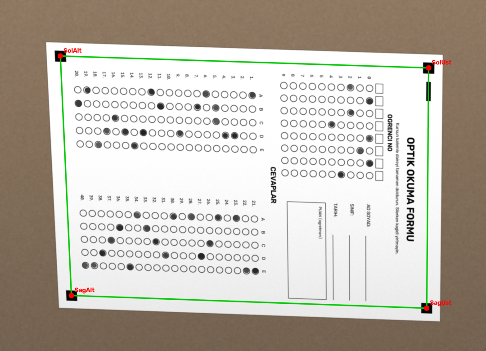
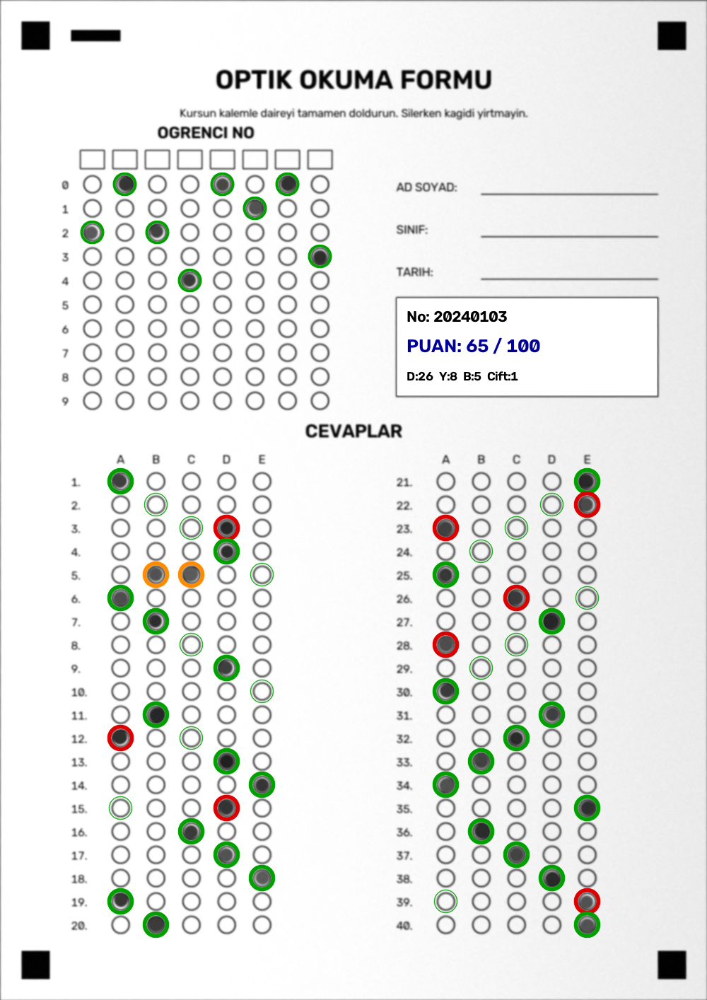

# Optik Form Okuyucu (OpenCV OMR)

Telefonla çekilmiş ya da taranmış **optik formu** otomatik olarak hizalayan, **işaretli şıkları** tespit eden ve **cevap anahtarına göre puanlayan** Python projesi. Sadece `opencv-python` ve `numpy` kullanır.

| Fotoğraftan köşe tespiti | Puanlanmış sonuç |
|---|---|
|  |  |

## Özellikler

- Dört köşe işaretçisi ile **perspektif düzeltme** (eğik, dönük, yan veya baş aşağı çekilmiş fotoğraflar dahil)
- **Işık / gölge düzeltmesi** (morfolojik arka plan kestirimi)
- 40 soru × 5 şık (A–E) ve **8 haneli öğrenci numarası** okuma
- Boş, çift işaretli ve doğru/yanlış soruların ayrı ayrı tespiti
- Cevap anahtarı JSON dosyasından puanlama: soru başı puan, **yanlış cezası** (ör. 4 yanlış 1 doğruyu götürür), **iptal soru** (`X`)
- Renkli sonuç görseli (yeşil = doğru, kırmızı = yanlış, turuncu = çift işaret, ince yeşil halka = doğru cevap)
- Klasör içindeki tüm kâğıtları tek komutla puanlayıp **Excel'de açılabilir CSV** üretme
- Yazdırılabilir boş form üreticisi + kamerasız test için "sahte fotoğraf" simülatörü
- Türkçe karakterli klasör yollarında (`C:\Users\Çağrı\...`) sorunsuz çalışır

## Kurulum

Python 3.9+ gerekir.

```bash
git clone https://github.com/MerveTatvan/optik-form-okuyucu.git
cd optik-form-okuyucu

python -m venv .venv
# Windows (PowerShell):  .venv\Scripts\Activate.ps1
# macOS / Linux:         source .venv/bin/activate

pip install -r requirements.txt
```

VS Code'da: `Ctrl+Shift+P` → **Python: Select Interpreter** → `.venv` seçin. `F5` ile hazır **Demo** ve **Puanla** yapılandırmaları çalışır.

## Hızlı başlangıç

```bash
python main.py demo
```

Bu komut örnek öğrenci fotoğrafları üretir (`samples/`), puanlar ve sonuçları `outputs/` klasörüne yazar.

## Kendi sınavın için kullanım

**1) Boş formu üret ve yazdır**

```bash
python main.py generate-form        # forms/bos_form.png
```

A4'e **%100 / gerçek boyut** yazdırın ("sayfaya sığdır" da olur, ama köşedeki dört siyah kare **mutlaka** tam çıkmalı). Fotokopi çekilecekse siyah karelerin soluk çıkmadığından emin olun.

**2) Cevap anahtarını düzenle** — `data/answer_key.json`

```json
{
  "exam_name": "Matematik Vize",
  "answers": "ABCDEABCDEBCDEACDEABEDCBAEDCBADCBAEBCDAE",
  "points_per_question": null,
  "wrong_penalty": 0.25
}
```

| Alan | Anlamı |
|---|---|
| `answers` | Cevaplar (1–40 harf). Soru sayısı 40'tan azsa sadece o kadarı puanlanır. `X` = iptal soru, herkese doğru sayılır |
| `points_per_question` | Soru başı puan. `null` ise toplam 100 puan olacak şekilde otomatik bölünür |
| `wrong_penalty` | Her yanlış için düşülecek doğru oranı. `0.25` → 4 yanlış 1 doğruyu götürür. `0` → ceza yok. Boş ve çift işaret ceza almaz |

**3) Fotoğrafları puanla**

```bash
python main.py grade foto.jpg --key data/answer_key.json
python main.py grade kagitlar/ --key data/answer_key.json --debug
```

Çıktılar `outputs/` içine yazılır:

- `sonuclar.csv` — dosya, öğrenci no, doğru/yanlış/boş/çift, puan, cevap dizisi (`-` boş, `*` çift işaret)
- `<dosya>_sonuc.png` — renkli kontrol görseli
- `debug/<dosya>/` — (`--debug` ile) maske, bulunan köşeler, düzleştirilmiş form, ışık düzeltmesi

## Nasıl çalışır?

```
fotoğraf
  │ 1) ışık düzeltme + Otsu eşikleme            (align.py)
  │ 2) kontur → "dolu siyah kare" filtresi       → 4 köşe işaretçisi
  │ 3) köşeleri sırala + perspektif dönüşümü     → 1000x1414 düz form
  │ 4) yön çubuğuna bakarak 0/90/180/270° çöz
  ▼
düz form
  │ 5) ışık/gölge normalizasyonu                 (reader.py)
  │ 6) her balonun içinde koyu piksel oranı      → oran ≥ 0.40 ise "işaretli"
  ▼
okunan cevaplar (A–E, boş, çift)
  │ 7) cevap anahtarı ile karşılaştır            (grader.py)
  ▼
puan + renkli görsel + CSV                       (visualize.py, main.py)
```

Neden köşe işaretçileri? Kağıdın kenarını bulmak (kontur + 4 köşe) masa, gölge ve el yüzünden kırılgandır. Basılı siyah kareler hem hızlı hem güvenilir referans noktalarıdır. Balon konumları `omr/layout.py` içinde sabit koordinatlardır; form üretici ile okuyucu aynı dosyayı kullandığı için her zaman uyumludur.

## Ayarlar

| Parametre | Varsayılan | Ne zaman değiştirilir |
|---|---|---|
| `--dark-level` | 190 | Çok soluk kalem işaretleri kaçıyorsa **artırın**; boş balonlar işaretli görünüyorsa azaltın |
| `--mark-ratio` | 0.40 | Yarım doldurulmuş balonlar kaçıyorsa **azaltın**; silinmiş/lekeli balonlar yanlış sayılıyorsa artırın |

Doğru ayarı bulmak için `--debug` ile `4_isik_duzeltilmis.png` görselini inceleyin. Doldurulmuş balonlar belirgin siyah, boş alanlar beyaz olmalı.

## Formu özelleştirme

Soru sayısı, şık sayısı (A–D, A–E...), sütun düzeni ve öğrenci no hane sayısı `omr/layout.py` dosyasındaki sabitlerden değişir. Değişiklikten sonra `python main.py generate-form` ile formu yeniden üretin.

## Testler

```bash
pytest
```

Testler rastgele cevaplı sahte formlar üretir, bunları eğik, gölgeli, gürültülü, soluk kalemli, düşük çözünürlüklü ve 0/90/180/270° çevrilmiş fotoğraflara dönüştürür; okunan sonucu gerçek cevaplarla birebir karşılaştırır.

## Proje yapısı

```
optik-okuyucu/
├── main.py              # Komut satırı: generate-form | grade | demo
├── omr/
│   ├── layout.py        # Form yerleşimi (tek doğruluk kaynağı)
│   ├── align.py         # Köşe tespiti, perspektif düzeltme, yön bulma
│   ├── reader.py        # Balon doluluk ölçümü, cevap + öğrenci no okuma
│   ├── grader.py        # Cevap anahtarı ve puanlama
│   ├── visualize.py     # Renkli sonuç görseli
│   ├── pipeline.py      # Uçtan uca akış
│   ├── formgen.py       # Boş form üretimi, test formu doldurma, fotoğraf simülasyonu
│   └── io.py            # Türkçe yol destekli imread/imwrite
├── data/answer_key.json
├── forms/               # Üretilen boş form
├── samples/             # Demo fotoğrafları
├── tests/test_pipeline.py
└── docs/                # README görselleri
```

## Bilinen sınırlar ve geliştirme fikirleri

- Dört köşe işaretçisinden biri parmakla/gölgeyle kapanırsa hizalama hata verir (program bunu açık bir mesajla bildirir).
- Çift işaretli sorular geçersiz sayılır. İsterseniz silinmiş şık toleransı eklenebilir.
- Form üzerindeki yazılar OpenCV yazı tipi kısıtı nedeniyle ASCII'dir (`OGRENCI NO`). İsterseniz Pillow ile Türkçe karakterli yazı eklenebilir.
- Fikirler: çoklu sınav kitapçığı (A/B grubu) desteği, PDF/çok sayfalı tarama girişi, Flask/Streamlit ile web arayüzü, sonuçları veritabanına yazma.

## Lisans

MIT
